# 慧眼随动·端侧视觉云台

**基于安路 PH1P35 FPGA 与 HX1P35A 开发板的高清视频处理、端侧视觉感知与两轴云台系统。**

本作品以 SC500CS 摄像头为图像源，通过 MIPI CSI-2 采集 RAW10 图像，在 FPGA 内完成流式 ISP 处理、DDR 帧缓存、目标定位与显示合成，输出 1280×720@60Hz HDMI 视频。系统将图像处理、视觉感知与机电联动整合在同一平台，在线推理无需上位机参与。

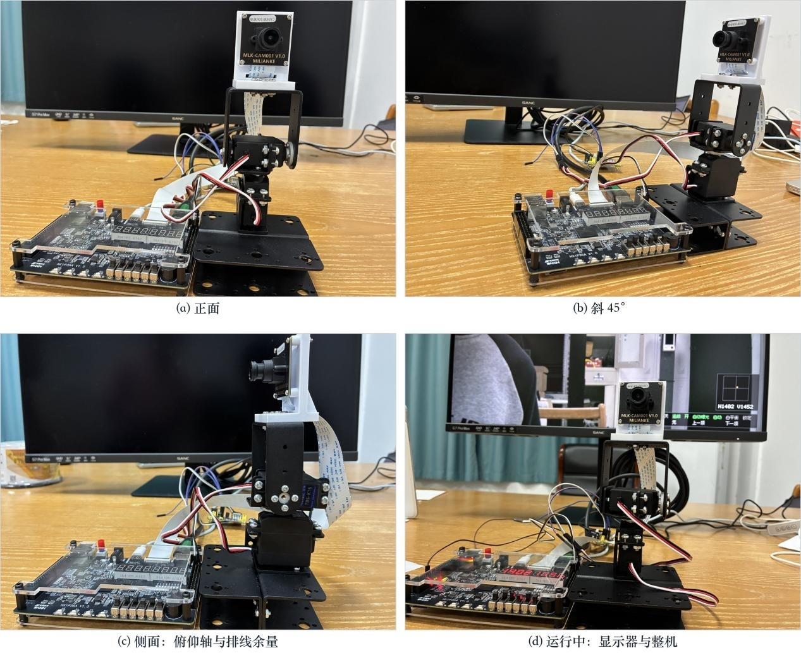

*整机实物：HX1P35A 开发板、SC500CS 摄像头与两轴云台。*

## 功能概览

系统把图像采集、色彩还原、实时特效、目标定位、中文显示与云台执行连在一起。主要应用包括人物居中跟随、指定图案或颜色物体跟随、固定机位运动观察，以及 FPGA 图像处理教学与演示。

| 功能 | 能做什么 |
| --- | --- |
| RAW ISP | 校正黑电平、镜头阴影与色偏，自动调节白平衡和曝光 |
| 实时图像处理 | 色彩还原与灰度、二值、锐化、边缘、卡通等图像效果 |
| 人脸检测 | FPGA 端运行 INT8 YuNet，定位人脸并提供云台跟随坐标 |
| 模板跟踪 | 按键选取画面中心图案，支持轻微旋转、尺度变化及丢失重捕 |
| 颜色区域跟踪 | 取样目标颜色，定位连通区域，支持换目标后重新取样 |
| 运动检测 | 在固定机位下标出变化区域，抑制孤立噪声和全局亮度突变 |
| 云台与交互 | 自动跟随、手动接管、丢失保持、目标重选及屏幕状态反馈 |

## 系统架构

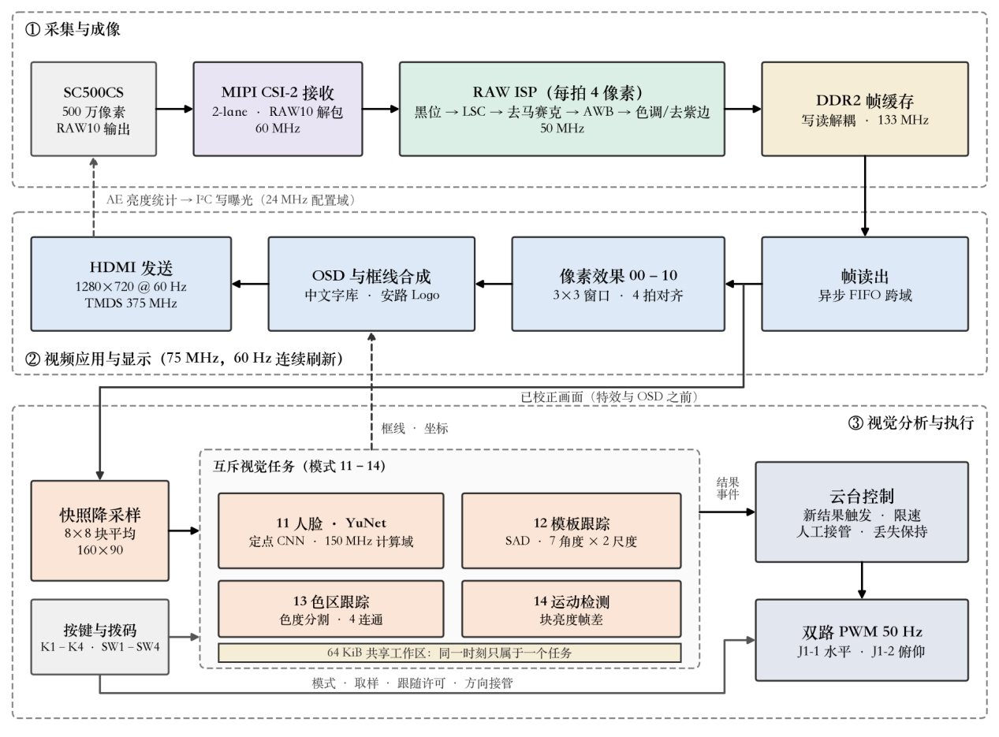

*校正后的画面分别送往显示与视觉任务，检测结果同时用于目标标注和云台控制。模板匹配使用七种角度及两种额外缩放变体，共九份模板，并非角度与尺度的全组合。*

系统按采集成像、视频显示、视觉分析与执行分工。视频链路连续输出，视觉任务按各自计算节奏发布结果；人脸、模板、色区和运动任务通过模式切换互斥运行，并复用存储工作区。视觉分析取用特效和 OSD 叠加之前的校正画面，显示滤镜不会成为检测输入。

HDMI 刷新、检测结果更新和舵机 PWM 是三个不同的节奏。60Hz 视频输出不代表每秒进行 60 次人脸推理，单次核心计算时间也不等于从摄像头曝光到云台动作的全部延迟。

### 视频缓存与时钟协同

采集、ISP、DDR2、视频与 CNN 各自按对应时钟运行，通过 FIFO、双口存储和握手交换数据。DDR2 帧缓存解耦摄像头写入与 HDMI 读取，视频显示持续刷新，CNN 运算不会阻塞视频时序。像素与帧边界一起传输，多位结果完整锁存后再通知接收域，保持图像、坐标与事件的一致性。

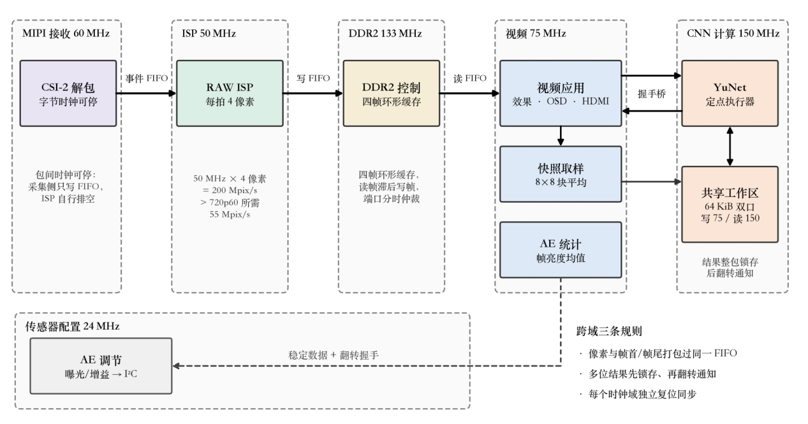

## 图像采集与色彩还原

摄像头通过 MIPI CSI-2 输入 RAW10 数据，采集侧以流式流水线处理图像，再将 RGB 画面写入 DDR2。ISP 按下图顺序推进，像素与帧首、行尾等同步标记保持对齐。

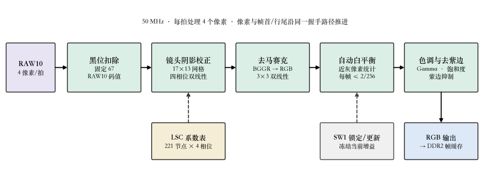

ISP 的各级作用如下：

1. **黑电平校正**：补偿传感器暗电平偏置，为后续颜色处理提供基准。
2. **镜头阴影校正**：根据平场标定结果，对 Bayer 各相位执行空间增益补偿，改善中心与边缘亮度、颜色不一致的问题。
3. **去马赛克与白平衡**：由 Bayer 数据重建彩色图像，按帧更新白平衡增益；可锁定当前增益进行固定条件观察。
4. **色彩与 Gamma 处理**：调整色彩、饱和度及明暗层次，并抑制部分紫色镶边。
5. **自动曝光**：统计画面亮度，通过传感器配置链路调节曝光与增益；可独立锁定。

### 空间校正与自动参数

全局白平衡调整整幅画面的通道比例，镜头阴影校正则解决颜色随画面位置变化的问题。系统通过均匀白场标定，在 Bayer 四个相位上分别建立 17×13 增益网格，再按像素位置进行双线性插值。下图展示报告中这组模组的校正形状：红、蓝通道的四角增益低于中心，绿色接近均匀，用于补偿边缘偏品红的色彩阴影。

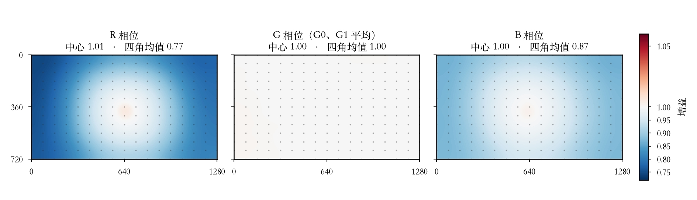

*图中增益对应报告中的镜头与标定条件，体现空间校正与全局白平衡的不同作用。*

自动白平衡根据近灰、未饱和像素统计更新通道增益，并限制帧间变化以平滑过渡；自动曝光依据画面亮度调节传感器曝光与模拟增益，形成从显示统计到传感器设置的反馈链路。

白平衡和曝光可分别控制。对比特效或进行颜色取样时，可以先等待画面稳定，再锁定参数，减少自动调整带来的观察差异。相关实现位于 `rtl/isp/`。

## 实时图像效果

00～10 共 11 个图像状态，包含基础色彩还原和 10 种附加效果。像素处理采用流水线和行缓存，邻域算法复用窗口数据，并对齐像素与同步信号。

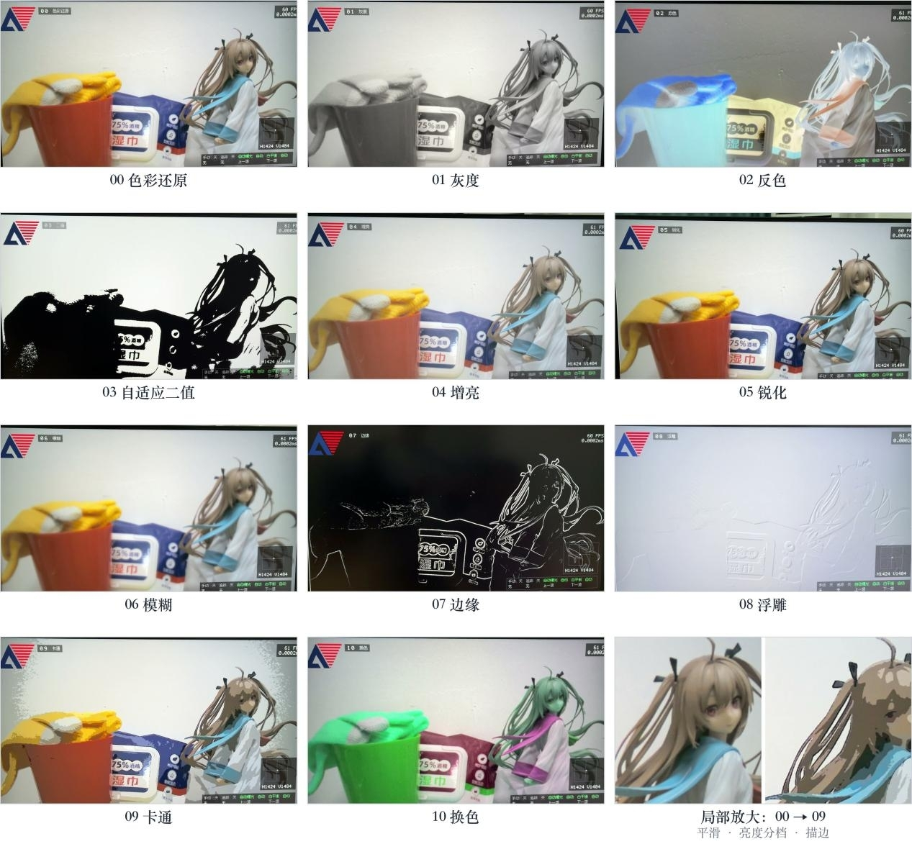

*同一场景下的色彩还原、灰度、反色、自适应二值、增亮、锐化、模糊、边缘、浮雕、卡通与换色。卡通模式结合平滑、亮度分档与描边。*

## 四类视觉任务

### 人脸检测与跟随

人脸模式在 FPGA 上执行 INT8 定点 YuNet。视频取样器对校正后的画面进行块平均，生成低分辨率图像，并按网络输入要求补边；网络通过多尺度检测头产生候选，解码后选择一个有效目标，将位置映射回显示画面，用于框线、坐标显示和云台控制。

当前模型由官方预训练权重微调后导出，训练预处理与板端取样流程对应。推理采用定点运算、并行点积、流水线和存储复用，在独立计算时钟域运行；模型准备、训练和评测在离线环境完成，设备在线运行不需要电脑或 OpenCV。

#### 网络结构与输入输出

YuNet 由轻量卷积主干、特征金字塔和多尺度检测头组成。主干使用逐点卷积与深度卷积提取特征，金字塔融合不同分辨率的语义与位置信息，三个检测头分别观察不同尺度的人脸。板端保留分类、目标性与框回归分支，不使用五点关键点分支。

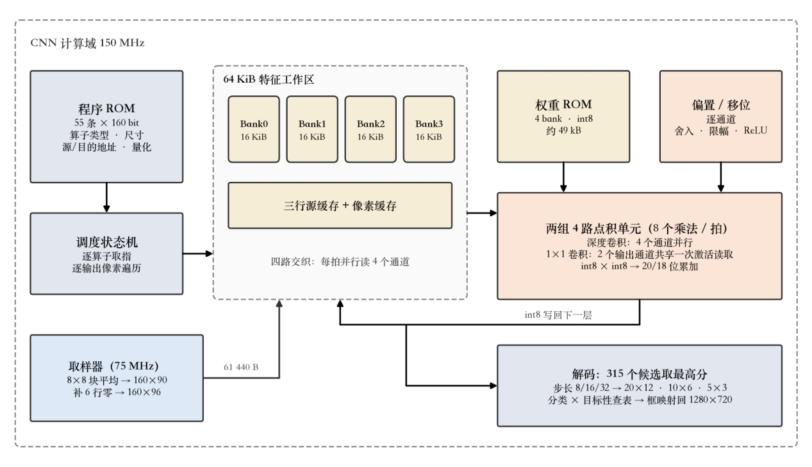

*采用技术报告原图：左下为输入取样，中部为特征存储与计算，右下为三个尺度检测头的解码与坐标映射。此图展示FPGA部署结构。*

| 检测尺度 | 特征网格 | 候选数量 | 输出用途 |
| --- | --- | --- | --- |
| 步长8 | 20×12 | 240 | 较细空间定位 |
| 步长16 | 10×6 | 60 | 中等尺度特征 |
| 步长32 | 5×3 | 15 | 较大感受野特征 |

三个尺度分别输出分类（cls）、目标性（obj）及边界框回归（bbox）。共315个候选，每个候选包含两项分数和四项框参数；解码器结合分类与目标性分数，选出满足阈值的最高分目标。训练沿用同一取样、通道顺序和补边约定，避免离线输入与板端图像准备方式脱节。

本项目微调保持检测网络结构，FPGA 使用160×96输入，不部署关键点分支。仓库包含已部署的微调模型及配套ROM，并保留自行训练、量化与导出的脚本。

#### 定点网络如何在FPGA上运行

网络各层由程序 ROM 描述，调度器逐条驱动卷积及特征操作；同一组点积单元分时执行不同层，避免给每层各自配置完整计算阵列。深度卷积并行处理通道，逐点卷积复用激活读取；权重、偏置、量化移位与中间特征分别组织，运算后舍入、限幅并写回定点特征。

上述原图中，程序ROM与调度状态机控制各层执行，特征工作区保存中间结果，解码器将最终检测头转换为画面坐标。

该模式提供人脸检测与定位，不提供身份识别、活体判断或多人分别跟随。输入输出约定见 [部署说明](scripts/yunet/DEPLOYMENT.md)。

### 模板、色区与运动任务的数据流

这三类任务使用同一低分辨率画面，按当前模式选择处理路径。模板保存图案并搜索，色区保存颜色并提取区域，运动模式保存前帧亮度并比较变化；最终都发布目标状态、中心与框线，供显示和控制使用。

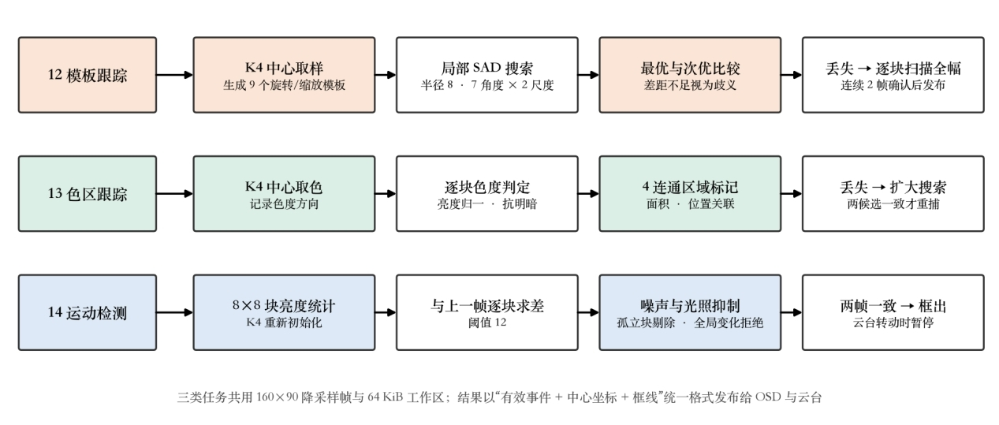

*模板分支的“七角度与两尺度”指共九种模板变体；色区与运动分支分别通过区域关联、连续帧确认减少误锁与噪声。*

### 多角度、多尺度模板跟踪

将待跟踪图案放在画面中心，按 K4 取样。系统保存局部灰度模板及旋转、缩放变体，随后在上次位置附近使用绝对差和（SAD）搜索，适应图案的轻微转动和远近变化。

重复纹理可能产生相近候选，系统对歧义匹配进行拒绝，避免直接跳到相似图案。目标丢失后进入分块搜索与重捕确认；也可把新图案移到中心，再按 K4 重新指定目标。该方法依赖局部纹理，不能把它理解为任意物体的语义识别。

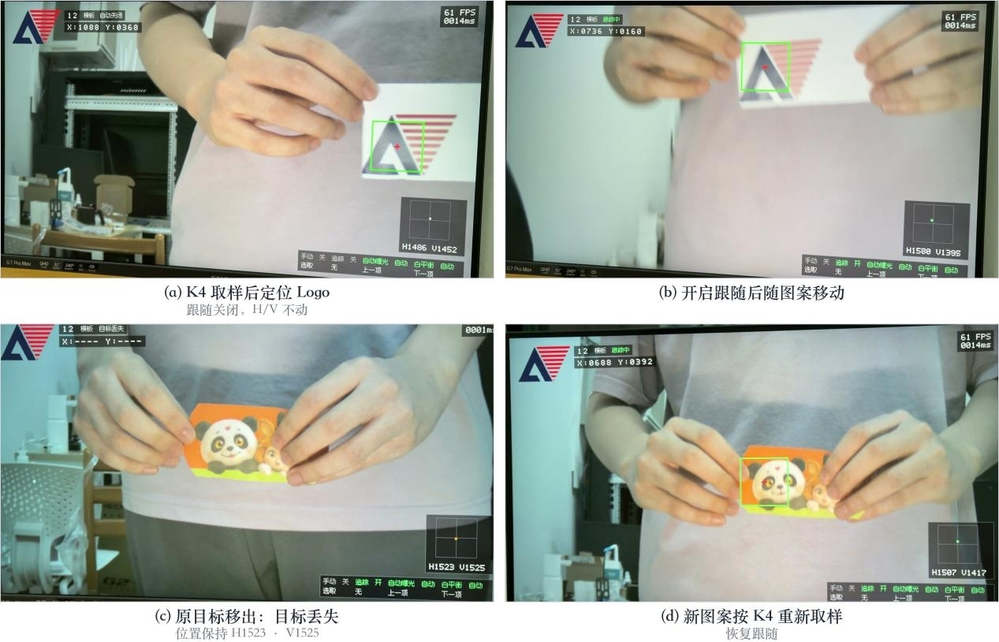

*取样图案 → 开启跟随 → 目标移出后保持云台位置 → 重新取样新图案。*

### 颜色区域跟踪

将目标颜色移到中心取样点，按 K4 记录颜色基准。系统依据色度关系进行分割，再提取连通区域，结合区域面积与历史位置确定目标，而不是简单地把所有相近颜色像素包进一个框。

目标丢失后扩大搜索并进行重捕确认；换成另一种颜色时，需要重新取样。建议取样前稳定并锁定白平衡。相近颜色背景、低饱和度物体和剧烈光照变化仍会影响结果。

### 固定机位运动检测

系统比较降采样画面的块亮度变化，结合相邻变化支持与连续帧确认，标出运动区域，同时抑制孤立噪声和全局亮度突变。按 K4 可重新初始化背景状态。

运动模式用于固定机位观察，不驱动自动云台；云台运动期间暂停检测，避免把相机移动造成的整幅画面变化当成目标运动。它检测的是画面变化，不区分人、物或事件类别。

## 两轴云台与机械结构

水平与俯仰两路舵机组成两自由度云台，摄像头通过 L 形安装座固定在俯仰机构上。安装时需给摄像头排线留出活动余量，并按实际装配限制机械行程。

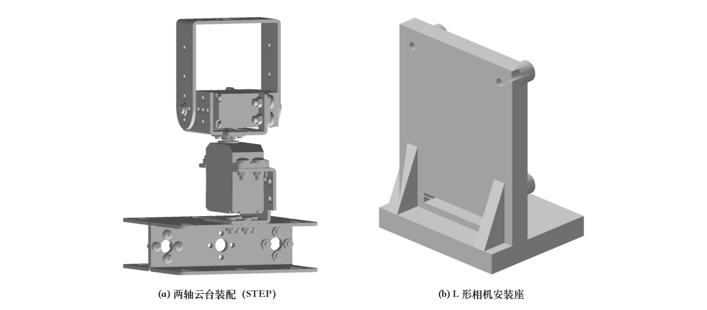

*云台装配与摄像头安装座设计示意。*

自动跟随仅用于人脸、模板和色区模式，并由 SW3 使能。控制器根据目标偏离画面中心的误差规划动作：

- **新结果触发**：在新检测结果到来时更新动作计划，避免反复使用旧坐标持续修正。
- **平滑逼近**：设置中心死区与输出变化限制，使云台逐步接近目标方向。
- **延迟补偿**：人脸等慢速结果结合取样时刻的云台位置计算修正，减少推理期间相机转动带来的偏差。
- **丢失保持**：目标消失或结果超时后停止继续修正，保持当前位置。
- **手动优先**：方向键可随时接管；松开后等待新结果再恢复自动跟随。

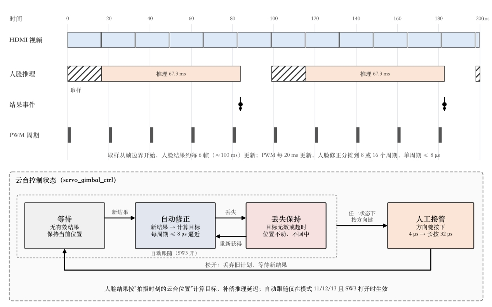

*上半图解释视频、推理和PWM的不同更新节奏；下半图连接等待、自动修正、丢失保持与人工接管。图中的时间对应报告配置，用于说明控制关系。*

舵机使用独立电源并与开发板共地。具体接线和供电规格应核对工程引脚约束、开发板及舵机资料，首次调试先确认机械行程。

## 屏幕与本地交互

HDMI 画面叠加中文模式名称、任务状态、目标框与坐标、视频刷新率、处理耗时、云台位置及开关状态；开发板数码管用于显示两轴控制输出，便于核对云台状态。

普通图像模式与视觉任务模式的耗时读数含义不同：前者观察应用像素链的处理延迟，后者显示当前任务的核心计算时间。图中 FPS 属于视频刷新，不能作为 CNN 推理频率。

说明图与实拍图来自作品技术报告。实拍读数及图中时间参数对应报告配置；本页用于介绍功能、结构与处理关系。

## 模式与操作

当前模式编号为 **00～14，共 15 个模式**：包含基础色彩还原和其余 14 个图像处理或视觉任务模式。

| 编号 | 模式 | 主要行为 |
| --- | --- | --- |
| 00 | 色彩还原 | 显示 ISP 校正画面 |
| 01 | 灰度 | 加权亮度输出 |
| 02 | 反色 | RGB 通道反相 |
| 03 | 自适应二值 | 根据画面亮度调整二值阈值 |
| 04 | 增亮 | 提高亮度并限幅 |
| 05 | 锐化 | 增强局部细节 |
| 06 | 模糊 | 平滑纹理与细节 |
| 07 | 边缘 | 提取亮度与颜色边界 |
| 08 | 浮雕 | 方向差分形成浮雕效果 |
| 09 | 卡通 | 平滑、分档与描边 |
| 10 | 换色 | RGB 通道轮换 |
| 11 | 人脸 | 自动检测、定位，可开启跟随 |
| 12 | 模板 | K4 取样图案，可开启跟随 |
| 13 | 色区 | K4 取样颜色，可开启跟随 |
| 14 | 运动 | 固定机位检测，K4 重新初始化 |

| 控件 | 功能 |
| --- | --- |
| SW1 / SW2 | 控制白平衡 / 曝光自动更新与锁定 |
| SW3 | 使能自动云台跟随 |
| SW4 | 将四个按键切换为云台方向控制；空闲时可恢复自动跟随 |
| K4 / K3 / K2 / K1（方向控制） | 左 / 下 / 上 / 右 |
| K1 / K2（普通操作） | 下一 / 上一模式 |
| K4（普通操作） | 按当前任务进行模板取样、颜色取样或运动背景重建 |

### 快速体验

1. 接好摄像头、HDMI 显示器和两轴舵机，确认供电、共地与机械行程，下载与该硬件配置对应的程序。
2. 先关闭自动跟随，确认基础画面和 OSD；开启自动白平衡、曝光，等待画面稳定。
3. 用 K1 / K2 切换图像模式，观察效果；需要固定条件对比时锁定白平衡和曝光。
4. 人脸模式下让目标进入画面；模板或色区模式下把目标移到画面中心并按 K4 取样，再开启 SW3 跟随。
5. 需要手动调整时打开 SW4，使用方向键接管；运动检测则保持机位固定，按 K4 初始化后观察变化区域。

## 仓库导航

| 目录 | 内容 |
| --- | --- |
| rtl | 应用集成、ISP、检测跟踪、控制、OSD 与硬件接口 |
| assets | 字模、Logo、校准数据、ROM 资源与模型来源 |
| scripts | 工程检查、构建、仿真、资源生成与离线模型工具 |
| sim | 视频、ISP、CNN、跟踪、控制与 OSD 仿真 |
| td_project | TD 工程与时序约束 |

模型训练、评测与导出在离线环境完成；PC 不参与设备运行时的在线推理。仓库保留完整开发历史、网络执行逻辑、离线工具、已部署的微调模型、配套ROM及逐层参考数据；可使用现有资源编译，也可自行微调后成套导出新的模型资源。
